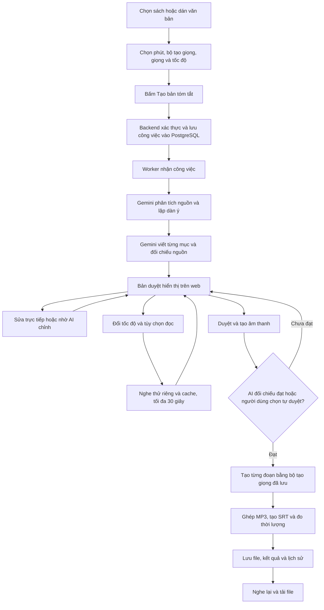

# Quy trình tạo sách nói từ tài liệu

**Cập nhật:** 25/10/2026  
**Phạm vi:** Luồng sách nói đang sử dụng trên hệ thống — `review-v1`.

**Bộ chọn giọng mới:** giữ lựa chọn bộ tạo giọng, bỏ ô Loại giọng đọc. Popup
có Giọng hệ thống (preset model + mẫu admin) và Giọng của bạn (mẫu riêng), kèm
Thêm giọng mới. Nhóm hiển thị khác với mode kỹ thuật: preset dùng standard,
mẫu upload dùng clone; hệ thống tự xác định khi gửi yêu cầu. Các giải thích về
hai mode bên dưới mô tả xử lý nội bộ, không yêu cầu thao tác chọn loại trên web.

Tài liệu mô tả quá trình từ lúc người dùng chọn sách đến khi có bản tóm tắt,
nghe thử, duyệt và nhận file âm thanh. Các chức năng và giới hạn bên dưới được
đối chiếu với mã hiện tại; số liệu cấu hình có thể thay đổi ở các phiên bản sau.

## 1. Hiểu nhanh toàn bộ quy trình

Người dùng đưa tài liệu vào, chọn thời lượng và giọng, sau đó yêu cầu tạo bản
tóm tắt. Worker gọi Gemini để phân tích, lập dàn ý, viết và đối chiếu nội dung.
Khi bản nháp sẵn sàng, người dùng có thể sửa, đổi tốc độ và nghe thử. Chỉ sau
khi người dùng duyệt, hệ thống mới tạo toàn bộ âm thanh và lưu vào lịch sử.



Nghe thử là lựa chọn trước khi duyệt, không phải bước bắt buộc. Trong lúc chờ
worker hoặc AI, người dùng có thể rời trang và mở lại yêu cầu từ danh sách gần đây.

## 2. Vai trò của từng thành phần

| Thành phần | Vai trò trong quy trình |
|---|---|
| Frontend Vue | Đọc tài liệu, nhận cấu hình, hiển thị bản duyệt, tiến độ và phát âm thanh. |
| Keycloak | Quản lý đăng nhập; cung cấp access token để Backend xác thực người dùng. |
| Backend Express | Kiểm tra quyền, dữ liệu đầu vào và phiên bản bản nháp; lưu công việc và nhận thao tác của người dùng. |
| PostgreSQL `tts_app` | Lưu nội dung nguồn, công việc, cấu hình giọng, bản nháp, điểm lưu, kết quả và lịch sử. |
| Worker sách nói | Nhận công việc nền, gọi Gemini, gọi Engine, lưu tiến độ và xuất bản kết quả. |
| Gemini | Phân tích sách, lập dàn ý, viết/chỉnh bản tóm tắt và đối chiếu với nguồn. |
| Engine FastAPI | Tạo từng đoạn âm thanh, xử lý giọng mẫu, chuẩn hóa, thêm nghỉ và ghép file. |
| Edge-TTS + OpenVoice | Một lựa chọn tạo âm thanh: Edge sinh giọng nền; OpenVoice chuyển âm sắc khi dùng giọng mẫu. |
| VieNeu-TTS | Lựa chọn khác, chạy trong service riêng, dùng giọng có sẵn hoặc clone từ mẫu. |
| Cloudflare R2 | Lưu file âm thanh nếu đã cấu hình R2; PostgreSQL lưu thông tin/key để truy cập file. |
| Docker Compose | Khởi động và kết nối các dịch vụ, cung cấp volume, cache và mạng nội bộ. |

**Gemini xử lý nội dung; Edge-TTS/OpenVoice hoặc VieNeu tạo tiếng nói.** Chọn
VieNeu không thay Gemini bằng một AI tóm tắt khác.

## 3. Bước 1 — Đưa sách vào hệ thống

### 3.1. Người dùng thao tác

1. Mở trang **Sách nói AI** sau khi đăng nhập.
2. Chọn file **TXT, MD (Markdown), DOCX hoặc PDF**, hoặc dán nội dung vào ô văn bản.
3. Kiểm tra nội dung đã đọc được trong ô nhập.
4. Điền tên sách/tài liệu; bổ sung tác giả và nguồn nếu biết.

### 3.2. Hệ thống xử lý

- Trình duyệt đọc TXT/MD trực tiếp, trích văn bản DOCX bằng Mammoth và PDF bằng PDF.js. File MD giữ tiêu đề, danh sách và ký hiệu Markdown trong nội dung nguồn; không tải ảnh/liên kết hay thực thi HTML trong file.
- Nội dung được đưa vào ô văn bản để người dùng xem và chỉnh trước khi gửi.
- Khi bấm tạo bản tóm tắt, Frontend gửi **văn bản đã trích xuất** đến Backend.
  Luồng này không tải nguyên file PDF/DOCX lên R2 để Gemini đọc trực tiếp.
- Tên sách được gợi ý từ tên file; tác giả và nguồn cần người dùng cung cấp.
  Hệ thống không tự coi tên file là bằng chứng về tác giả hoặc nội dung sách.

### 3.3. Giới hạn hiện tại

| Nội dung | Giới hạn |
|---|---|
| Dung lượng file đầu vào | Tối đa 30 MB khi chọn file trên web. |
| Văn bản gửi tạo yêu cầu | Từ 500 đến 1.000.000 ký tự. |
| PDF | Tối đa 1.000 trang và vẫn phải nằm trong giới hạn ký tự. |
| PDF scan chỉ có hình ảnh | Cần chuyển thành văn bản bằng OCR trước; luồng này chưa tự OCR. |

Nếu vượt giới hạn, giao diện báo lỗi để chia tài liệu. Hệ thống không chủ động
cắt bỏ các trang phía sau rồi coi đó là toàn bộ sách.

## 4. Bước 2 — Chọn thời lượng mục tiêu

Người dùng chọn nhanh **10, 20 hoặc 30 phút**, hoặc nhập **số phút nguyên 1–59**.

Thời lượng là mục tiêu để hệ thống lập dàn ý và tính độ dài bản tóm tắt. Ví dụ,
chọn 10 phút sẽ hướng đến nội dung ngắn hơn so với chọn 30 phút trên cùng nguồn.
Tốc độ chọn ban đầu cũng được đưa vào tính ngân sách viết.

Luồng duyệt mới đo một đoạn đọc mẫu ở tốc độ 1,00x bằng đúng bộ tạo giọng và
giọng đã chọn. Tốc độ đo được được lưu trong `reading_profiles` tối đa 30 ngày,
tách theo model, mẫu và phiên bản, rồi dùng để tính độ dài thay cho hằng số 300
đơn vị/phút. Phép đếm là đơn vị phân cách bằng khoảng trắng (gần âm tiết tiếng Việt).
Thời lượng ước tính trong bản duyệt cũng dùng tốc độ đo này và cấu hình đọc hiện tại.

Gemini được giao ngân sách từng mục; hệ thống đếm kết quả thật, chỉnh lại mục
lệch độ dài tối đa một lượt và kiểm tra lại sau đối chiếu nguồn. Có thêm tối đa
một lượt căn mỗi mục sau đối chiếu, rồi đối chiếu nội dung mới. Số lượt được lưu
trong checkpoint để retry không tạo vòng lặp viết vô hạn. Đây là cố gắng bám mốc,
không phải cam kết file cuối chính xác đến từng giây.

Nếu dự kiến lệch quá 15%, bản duyệt hiển thị mục tiêu/thời lượng dự kiến và nút
**Căn lại thời lượng** (AI chỉnh toàn bộ theo nguồn và tốc độ hiện tại). Khi vẫn
chọn tạo âm thanh, popup nêu rõ độ dài dự kiến và Backend yêu cầu xác nhận độ
lệch cho đúng revision đã lưu. Ngân sách lấy độ dài nguồn làm trần ước tính,
đã bỏ cap cố định 55%; nguồn quá ngắn bị chặn theo bước kiểm tra dưới đây.
File đã hoàn tất không tự viết lại: muốn căn lại cần quay lại bản duyệt còn tồn tại
hoặc tạo yêu cầu mới.

Thời lượng thực tế vẫn phụ thuộc vào:

- Số lượng nội dung có thể tóm tắt trung thực từ nguồn.
- Nội dung cuối cùng được người dùng duyệt.
- Tốc độ của bộ tạo giọng và mức tốc độ người dùng chọn.
- Khoảng nghỉ giữa các đoạn và các mục.

Khi nguồn quá ngắn so với mốc yêu cầu, Backend trả lỗi `SOURCE_TOO_SHORT` (HTTP
422) trước khi tạo job hoặc gọi Gemini. Popup cho quay lại ô thời lượng; menu
gợi ý mốc ngắn hơn và có nút chọn mốc đó. Nếu chưa phù hợp với cả 1 phút, người
dùng cần bổ sung nguồn. Chọn lại rồi bấm **Tạo bản tóm tắt** để gửi yêu cầu mới.
Nguồn, tên sách, giọng và các ô đã nhập được giữ lại trên trang.

Kiểm tra đầu vào dùng tốc độ đo đã cache khi có; nếu chưa có, dùng ước tính
300 đơn vị/phút. Worker kiểm tra lại sau khi đo đúng giọng, trước Gemini. Nếu
lúc đó mới phát hiện nguồn quá ngắn, job dừng và chỉ dẫn gửi lại với mốc khác,
không tự thử cùng đầu vào mãi. Đây là sàng lọc định lượng theo độ dài nguồn và
tốc độ đọc, chưa đánh giá được mọi trường hợp thiếu thông tin về mặt ngữ nghĩa.
AI vẫn không được bịa, lặp ý hoặc thêm nhận xét rỗng để cố đủ phút. File âm
thanh hoàn tất vẫn phải dưới 1 giờ.

Prompt mới yêu cầu triển khai sâu các dữ kiện, bối cảnh, lập luận và nhân quả
được nguồn chứng minh. Tâm lý/động cơ nhân vật chỉ diễn giải khi có bằng chứng;
không suy đoán để kéo dài. Số câu (khoảng target/22) và số đoạn (khoảng target/90)
là gợi ý mềm, không bắt mọi mục phải có ít nhất hai đoạn 4–6 câu. AI không kết
luận thiếu nguồn ngay vì bản đầu ngắn. Lượt chỉnh còn ngắn có thể truy xuất mở
rộng tối đa 12 phần/16.000 ký tự nguyên văn thay cho 8 phần/11.000 ký tự; đối
chiếu dùng cùng mức truy xuất mở rộng cho phần đó. Có fallback khi quá ngân
sách token và vẫn giới hạn số lượt viết.

## 5. Bước 3 — Chọn bộ tạo giọng và giọng đọc

### 5.1. Chọn bộ tạo giọng

| Lựa chọn | Giọng có sẵn | Giọng cá nhân/giọng mẫu |
|---|---|---|
| **Edge-TTS + OpenVoice** | Edge-TTS tạo trực tiếp bằng Hoài My hoặc Nam Minh. | Edge-TTS tạo âm thanh nền, rồi OpenVoice chuyển sang âm sắc của mẫu đã chọn. |
| **VieNeu-TTS** | VieNeu tạo bằng preset được chọn. | VieNeu dùng mẫu để clone trực tiếp; không đi qua Edge-TTS và OpenVoice. |

VieNeu là một nhánh lựa chọn bổ sung; nhánh Edge-TTS/OpenVoice vẫn được giữ.
Hệ thống không tự chuyển sang bộ tạo giọng khác khi xảy ra lỗi.

### 5.2. Chọn loại giọng và tên giọng

- **Giọng có sẵn:** chọn một tên cụ thể trong danh sách của bộ tạo giọng.
- **Giọng cá nhân:** chọn từ thư viện mẫu mà tài khoản được phép dùng, gồm giọng
  dùng chung và giọng riêng của người dùng.

Các preset VieNeu hiện được đưa lên giao diện là Hải Đăng, Trúc Ly, Thiện Minh
và Mai Anh. Danh sách giọng mẫu cá nhân phụ thuộc dữ liệu đang có và quyền của
tài khoản.

Backend kiểm tra giọng còn hoạt động và người dùng có quyền sử dụng. AI không
tự quyết định đổi tên giọng hoặc chuyển nam/nữ giữa các đoạn của cùng yêu cầu.

## 6. Bước 4 — Chọn tốc độ và tùy chọn đọc

Khi tạo yêu cầu mới, sidebar cho chọn tốc độ chung. Nhóm tùy chọn chi tiết
(phong cách từng đoạn, chuẩn hóa và từ điển) được chỉnh ở phần cấu hình của
bản duyệt sau khi đã có bản tóm tắt. Phần này giải thích công dụng của cả hai.

### 6.1. Thanh tốc độ chung

- Phạm vi: **0,75x–1,50x**, bước 0,05x; mặc định cho cấu hình mới là **1,00x**.
- Áp dụng cho toàn bộ lời đọc, gồm lời giới thiệu và các mục.
- Có thể thay đổi sau khi đã có bản tóm tắt, trước khi tạo âm thanh.
- Đây là tốc độ dùng khi tạo file, không phải chỉ thay tốc độ phát trên trình nghe.

Edge-TTS nhận tham số tốc độ khi sinh giọng nền. Với VieNeu, Engine điều chỉnh
tốc độ đầu ra bằng FFmpeg `atempo`, giữ cao độ. Thay tốc độ không tự viết lại nội
dung đã duyệt để bù về số phút mục tiêu.

### 6.2. Phong cách và khoảng nghỉ

Trong cấu hình có tốc độ chung, thanh kéo quyết định tốc độ cho mọi đoạn. Các
phong cách bên dưới chủ yếu khác nhau ở khoảng nghỉ hệ thống thêm vào:

| Phong cách | Nghỉ giữa các đoạn | Nghỉ cuối một mục |
|---|---:|---:|
| Tự nhiên | 0,40 giây | 0,65 giây |
| Giảng giải | 0,60 giây | 0,85 giây |
| Kể chuyện | 0,55 giây | 0,80 giây |
| Bản tin | 0,25 giây | 0,45 giây |
| Thư giãn | 0,75 giây | 1,00 giây |

Một dòng trống phân chia các đoạn. Ở cuối mục, dùng mức nghỉ cuối mục, không cộng
cả hai cột. Công cụ TTS còn có nhịp ngắt tự nhiên theo dấu câu.

**Theo phong cách ban đầu** dùng phong cách được xác định trong dàn ý: kiểu truyện
chọn Kể chuyện, kiểu tin chọn Bản tin, còn lại dùng Tự nhiên. Có thể đặt riêng
cho từng mục/đoạn; phong cách riêng của đoạn được ưu tiên hơn mục và cấu hình chung.
Các preset này chưa phải chức năng diễn xuất vui/buồn, thì thầm hoặc tạo tiếng cười.

### 6.3. Chuẩn hóa và từ điển

- **Đọc số, ngày, đơn vị:** chuyển dạng viết sang dạng đọc, ví dụ `10 kg` thành
  “mười ki lô gam”.
- **Từ điển phát âm:** thay cách đọc cho từ/tên riêng, ví dụ `TP.HCM` thành
  “Thành phố Hồ Chí Minh”.

Các tùy chọn này tác động đến văn bản đưa vào TTS; không thay nội dung tóm tắt
gốc hiển thị trong bản duyệt. Nút và khung **Xem cách đọc** đã bỏ; lập kế hoạch
đọc và kiểm tra cấu hình vẫn được thực hiện tự động hoặc khi người dùng bấm hành động.

## 7. Bước 5 — Gửi yêu cầu tạo bản tóm tắt

Khi bấm **Tạo bản tóm tắt**, Frontend gọi `POST /api/book-jobs`.

| Nhóm dữ liệu | Nội dung gửi |
|---|---|
| Sách | Văn bản nguồn, tên sách, tác giả và nguồn tài liệu. |
| Mục tiêu | Số phút được chọn. |
| Giọng | Bộ tạo giọng, loại giọng và mã giọng cụ thể. |
| Cách đọc ban đầu | Cấu hình tốc độ chung. |
| Mã gửi yêu cầu | `request_id` để lần gửi lại do lỗi mạng không tạo trùng công việc. |

Backend xác thực access token, kiểm tra dữ liệu và quyền dùng giọng. Nếu hợp lệ,
Backend tạo công việc trong PostgreSQL và trả về trạng thái chờ xử lý. Người dùng
được phép có tối đa 3 yêu cầu đang chờ/đang xử lý theo giới hạn hiện tại.

Giọng và bộ tạo giọng được chụp lại trong `selected_voice`; tốc độ ban đầu được
lưu trong `checkpoint.initial_speech`. HTTP nhận yêu cầu không cần giữ kết nối
cho đến khi Gemini và TTS xử lý xong.

Frontend định kỳ lấy tiến độ và danh sách yêu cầu. Nếu worker đang tắt, yêu cầu
vẫn nằm trong hàng đợi và chờ dịch vụ hoạt động.

## 8. Bước 6 — Worker gọi Gemini xử lý sách

Worker là tiến trình chạy nền, nhận công việc từ PostgreSQL. Worker giữ quyền
xử lý có thời hạn và cập nhật định kỳ để tránh nhiều worker cùng nhận một công
việc. Tiến độ và kết quả trung gian được lưu bằng checkpoint.

### 8.1. Chia văn bản và phân tích từng phần

- Yêu cầu mới mặc định chia nguồn khoảng **12.000 ký tự/phần**, có cấu hình
  trong khoảng 6.000–16.000. Kích thước được lưu theo yêu cầu.
- Yêu cầu cũ không có cấu hình này vẫn dùng 6.000 ký tự để giữ đúng liên kết nguồn.
- Gemini nhận từng phần và trả dữ kiện có cấu trúc: thể loại, ý chính, nhân vật/
  thực thể và vai trò, sự kiện/luận điểm, nguyên nhân–hệ quả, chủ đề và điểm chưa rõ.
- Nếu nguồn không nêu nguyên nhân hoặc kết quả, AI được yêu cầu ghi thiếu thông
  tin thay vì suy diễn.

Từ 25/10, yêu cầu mới lưu `analysis_strategy=adaptive-v1`. Các phần nguồn vẫn
giữ ID nhỏ để truy xuất đúng nguyên bản; worker gom tối đa 4 phần trong một
lượt phân tích khi vừa ngân sách. Nguồn ngắn vừa ngân sách có thể phân tích
và lập dàn ý trong cùng một lượt. Không mặc định gửi 150.000 ký tự bất kể model.
Nếu vượt token, JSON sai, đầu ra bị cắt thì chia nhóm nhỏ hơn; timeout lưu lựa
chọn nhóm nhỏ rồi chờ lịch retry chung. Lỗi quota/xác thực không được dùng làm
lý do gọi dồn các nhóm. Checkpoint cũ giữ cách chia/phân tích cũ.

### 8.2. Gộp dữ kiện và lập dàn ý

Worker gộp ghi chú thành cái nhìn chung; nếu dài thì thực hiện các lượt rút gọn
có lưu tiến độ. Gemini lập dàn ý theo thể loại, thời lượng và lượng dữ liệu nguồn.

Mỗi mục có tiêu đề, trọng tâm và danh sách phần nguồn liên quan. Với truyện, dàn
ý hướng theo hoàn cảnh, xung đột, bước ngoặt và kết quả; sách kiến thức hướng
theo vấn đề, luận điểm, giải thích và kết luận.

### 8.3. Viết bản tóm tắt theo từng mục

Worker chọn lại các trích đoạn nguồn liên quan rồi gửi Gemini cùng dàn ý và đoạn
cuối mục trước để nối mạch. AI viết từng mục bằng tiếng Việt đầy đủ dấu, giữ tên
riêng, quan hệ, dữ kiện và nguyên nhân–kết quả.

Yêu cầu biên tập bao gồm: diễn đạt riêng, không sao chép nguyên văn, không thêm
tình tiết/số liệu để kéo dài và không tái hiện từng cảnh hoặc hội thoại chi tiết.
Lời giới thiệu gồm nhãn AI, tên sách và tác giả được hệ thống tạo riêng từ thông
tin người dùng nhập. Tác giả/nguồn chưa biết được ghi nhận là chưa cung cấp.

Với yêu cầu mới, sau phần giới thiệu là một trong bốn câu dẫn viết sẵn, chẳng
hạn “Phần nội dung chính xin được bắt đầu.” hoặc “Và bây giờ, mời bạn cùng bước
vào nội dung của cuốn sách.” Các câu được luân phiên theo tài khoản. Câu đã
chọn được giữ trong bản nháp, dùng nhất quán khi tạo tiếng nói hoặc tiếp tục từ
checkpoint; không chọn lại ngẫu nhiên giữa các lần gọi. Lời dẫn có trong lời
giới thiệu của file đầy đủ; mẫu nghe thử 30 giây vẫn lấy nội dung chính như trước.

### 8.4. Một lượt gọi Gemini diễn ra như thế nào?

Worker đọc API key từ cấu hình máy chủ; trình duyệt không giữ API key Gemini.
Model lấy từ `GEMINI_MODEL`, mặc định trong mã là `gemini-flash-latest`.

Trình tự chính:

1. Kiểm tra công việc chưa bị hủy và tài khoản vẫn hợp lệ.
2. Tạo prompt cho nhiệm vụ hiện tại, kèm quy tắc biên tập và schema JSON.
3. Ước lượng cục bộ trước. Prompt nhỏ không gọi `countTokens`; khi ước lượng
   đạt 60% ngân sách thì đếm qua mạng và lưu kết quả 15 phút. Ngân sách mặc
   định 24.000 token đầu vào (`GEMINI_INPUT_TOKEN_BUDGET`); ước lượng có biên
   dự phòng và được điều chỉnh tăng từ `usageMetadata`. Đây không phải bộ
   tokenizer chính xác, không dùng cố định quy tắc ký tự/3,5 cho mọi nguồn.
4. Gọi `generateContent` qua bộ điều tiết yêu cầu. Nhiệt độ cấu hình là 0,35;
   số token đầu ra được đặt riêng cho từng nhiệm vụ.
5. Đọc JSON, kiểm tra kiểu dữ liệu, độ dài và các điều kiện tiếng Việt liên quan.
   Không sử dụng phản hồi bị cắt hoặc JSON không hợp lệ.
6. Lưu kết quả và tiến độ trước khi chuyển sang bước tiếp theo.

Đây là **nhiều lượt gọi có nhiệm vụ riêng**, không phải một lần gửi cả cuốn sách
rồi nhận ngay file âm thanh. Phân tích, gộp ghi chú, lập dàn ý, viết và đối chiếu
đều có thể phát sinh lượt API riêng.

## 9. Bước 7 — Đối chiếu bản tóm tắt với nguồn

Sau khi viết, worker gọi Gemini bằng prompt đối chiếu riêng với lượt viết.
Mỗi lượt đối chiếu gom tối đa 3 mục nếu vừa ngân sách, trả kết quả tách biệt
theo ID; nhóm lớn không hợp lệ được tách nhỏ. Mỗi mục chỉ dùng nguồn của mình.
Lượt đối chiếu nhận bản nháp, thông tin mục, cuối mục trước, ghi chú và các đoạn
văn gốc liên quan.

Kết quả từng mục được lưu trong checkpoint xuyên các lần sửa/duyệt. Khóa cache
gồm văn bản mục, cuối mục trước, tiêu đề/trọng tâm, bằng chứng đã truy xuất,
hash nguồn, model và phiên bản prompt. Mục không đổi đúng các yếu tố đó được
dùng lại; mục sửa hoặc ngữ cảnh liên quan thay đổi được kiểm tra lại. Chỉ đổi
tốc độ hay khoảng nghỉ không tạo lượt Gemini đối chiếu mới.

Các vấn đề cần phát hiện:

- Sai tên, vai trò hoặc quan hệ nhân vật.
- Sai sự kiện, trình tự hoặc nguyên nhân–hệ quả.
- Sai luận điểm/số liệu hoặc thêm ý không được nguồn hỗ trợ.
- Chủ thể mơ hồ, nội dung khó hiểu, lặp lại mục trước hoặc thiếu dấu tiếng Việt.

AI trả `passed`, `issues` và `corrected_text`. Ở lượt tạo/chỉnh bản tóm tắt, nếu
chưa đạt nhưng có thể sửa trung thực, worker dùng bản sửa và kiểm tra lại thêm
một lượt; tối đa 2 lượt đối chiếu cho mục trong vòng này. Nếu vẫn chưa đạt,
nhận xét được đưa về bản duyệt để người dùng xem.

Việc truy xuất hiện chọn tối đa 8 phần nguồn đã liên kết với mục, xếp theo từ
khóa, với tổng ngân sách khoảng 11.000 ký tự nguyên văn và 4.500 ký tự ghi chú.
Số “Phần nguồn tham chiếu” là số phần nội bộ, không phải số trang PDF.

Lượt viết và lượt kiểm tra là các lần gọi riêng nhưng dùng cùng mô hình Gemini
đang cấu hình. Nhãn **Đã đối chiếu nguồn bằng AI** thể hiện kết quả kiểm tra trên
những bằng chứng đã chọn, không bảo đảm bản tóm tắt đúng tuyệt đối. Người dùng
vẫn cần đọc lại, nhất là tên riêng, số liệu và chi tiết quan trọng.

## 10. Bước 8 — Nhận và chỉnh bản duyệt

Khi hoàn thành giai đoạn văn bản, công việc chuyển sang **Chờ duyệt nội dung**.
Hệ thống chưa tạo toàn bộ sách nói ở thời điểm này.

Người dùng có thể:

1. Đọc từng mục và các nhận xét cần xem lại.
2. Sửa trực tiếp nội dung rồi lưu.
3. Nhờ AI chỉnh toàn bộ bản tóm tắt hoặc một mục cụ thể.
4. Đổi tốc độ chung, phong cách, chuẩn hóa và từ điển phát âm.
5. Nghe thử, duyệt tạo toàn bộ âm thanh hoặc hủy/xóa yêu cầu.

**Sửa trực tiếp:** Backend kiểm tra nội dung và phiên bản `draft_revision`. Nếu
một tab khác đã đổi bản nháp, yêu cầu cũ bị từ chối để tránh ghi đè. Thay đổi nội
dung làm mất xác nhận đối chiếu cũ; chỉ đổi cấu hình đọc không tự xóa xác nhận nếu
văn bản tóm tắt giữ nguyên.

**Nhờ AI chỉnh:** Worker gửi nội dung, yêu cầu chỉnh và bằng chứng nguồn cho
Gemini. AI vẫn phải tuân thủ nguồn; sau khi chỉnh sẽ qua bước đối chiếu rồi trả
về bản duyệt mới. Hành động này có gọi Gemini.

**Đổi tốc độ:** Chỉ thay cấu hình tạo tiếng nói, không cần gọi Gemini viết lại.
Khi bấm nghe thử hoặc duyệt, giao diện lưu các thay đổi trước khi gửi hành động.

## 11. Thiết lập nào còn thay đổi được sau khi có bản duyệt?

| Thiết lập | Cách áp dụng trong phiên bản hiện tại |
|---|---|
| Nội dung tóm tắt | Sửa ở bản duyệt; mặc định đối chiếu lại các mục bị ảnh hưởng, hoặc chủ động chọn tự duyệt sau khi sửa tay. |
| Tốc độ đọc | Dùng giá trị mới nhất trong bản duyệt khi bấm nghe thử/duyệt tạo. |
| Phong cách, chuẩn hóa, từ điển | Lưu cùng cấu hình bản duyệt và áp dụng cho lần tạo kế tiếp. |
| Giọng đọc | Giữ giọng đã chụp lúc gửi yêu cầu tóm tắt. |
| Bộ tạo giọng | Giữ Edge hoặc VieNeu đã chọn lúc gửi yêu cầu. |
| Số phút mục tiêu | Giữ mốc ban đầu đã dùng để viết bản tóm tắt. |

Đổi các dropdown giọng/bộ tạo giọng hoặc số phút ở khu vực tạo yêu cầu không đổi
những trường đã lưu của bản duyệt đang mở. Muốn đổi các trường này cho một sách,
hiện cần tạo yêu cầu mới.

Ví dụ: yêu cầu được tạo với VieNeu, giọng Hải Đăng, mục tiêu 10 phút và tốc độ
1,00x. Sau khi có bản duyệt, người dùng đổi tốc độ thành 1,20x rồi duyệt. File
dùng **VieNeu + Hải Đăng + tốc độ 1,20x**; mốc mục tiêu vẫn là 10 phút nhưng file
có thể ngắn hơn vì cùng nội dung được đọc nhanh hơn. Hệ thống không tự thêm lời
để bù thời gian.

## 12. Bước 9 — Nghe thử tối đa 30 giây

Khi bấm **Nghe thử tối đa 30 giây**:

1. Giao diện lưu nội dung/cấu hình hiện tại của bản duyệt nếu có thay đổi.
2. Hệ thống lập kế hoạch đọc và kiểm tra hash của đúng phiên bản đã lưu.
3. Backend kiểm tra cache và nhận công việc nghe thử riêng, trả trạng thái ngay;
   không đưa vào hàng đợi sách và không đổi trạng thái bản nháp khỏi `review`.
4. Backend chọn phần đầu của các mục tóm tắt, giới hạn số đoạn và ước lượng
   lượng chữ cho khoảng 30 giây. Lời giới thiệu không được thêm vào mẫu này.
5. Engine tạo âm thanh bằng giọng/bộ tạo giọng đã lưu và cấu hình đọc hiện tại.
6. Ghép mẫu, cắt file nghe thử tối đa 30 giây rồi trả về giao diện.
7. Web theo dõi trạng thái nghe thử riêng; người dùng tiếp tục duyệt sau khi có mẫu.

Cache lưu PostgreSQL trong bảng `book_previews`, file trên R2 hoặc local. Khóa
phụ thuộc nội dung, cấu hình đọc/tốc độ, giọng, provider, phiên bản model và mẫu
âm thanh. Cache trùng còn hiệu lực trả lại ngay, không gọi TTS. TTL 7 ngày,
giữ tối đa 5 cache hoàn tất còn hiệu lực mỗi job; worker dọn khi rảnh. Mỗi lần
chạy có thư mục riêng, không xóa nhầm các đoạn của sách hoặc lần thử mới.
Chỉ một lượt nghe thử mới được xử lý cùng lúc để giới hạn tải CPU. Engine ưu
tiên nghe thử tại ranh giới giữa hai đoạn, vẫn phải chờ đoạn đang chạy xong.
Lượt bị ngắt có lease 90 giây; sau khi hết lease có thể bấm thử lại. Khi sửa
nguồn/cấu hình hoặc hủy job, kết quả cũ không được đưa vào bản duyệt hiện tại.

Nghe thử sử dụng văn bản đã có, không gọi Gemini viết lại nội dung. Mục đích là
nghe giọng, tốc độ, khoảng nghỉ và cách phát âm; chưa phải xác nhận nội dung đã
đạt đối chiếu hoặc tạo xong toàn bộ sách nói. Mẫu có thể ngắn hơn 30 giây nếu
nguồn lấy mẫu ngắn. Thay đổi nội dung/cấu hình làm mẫu cũ không còn đại diện cho
thiết lập mới; cần nghe thử lại nếu muốn đánh giá thiết lập vừa đổi.

## 13. Bước 10 — Duyệt và tạo toàn bộ âm thanh

### 13.1. Lưu và kiểm tra phiên bản

Sau xác nhận duyệt, giao diện lưu thay đổi, lập kế hoạch đọc từ đúng bản đã lưu,
rồi gửi `POST /api/book-jobs/:id/audio` với revision và hash kế hoạch.

Backend kiểm tra quyền, trạng thái chờ duyệt, revision và hash. Nếu hợp lệ,
công việc được đưa vào hàng đợi và ghi lại phiên bản được duyệt.

### 13.2. Kiểm tra lại nội dung khi cần

Nếu nội dung khớp bản đã được đối chiếu đạt, worker dùng kết quả đó. Nếu nội dung
đã đổi hoặc chưa được xác nhận, worker đối chiếu lại trước khi tạo toàn bộ âm thanh.
Ở lượt này, nếu chưa đạt, worker trả bản nháp về chờ duyệt kèm nhận xét, không
tự âm thầm sửa bản người dùng vừa duyệt rồi xuất file.

Sau khi sửa tay có thêm ô **Tôi tự duyệt nội dung đã sửa, bỏ qua đối chiếu AI
lại**. Mặc định ô này tắt. Khi chọn và xác nhận, Backend lưu người duyệt, thời
điểm, revision và hash nội dung. Worker chỉ bỏ lượt đối chiếu khi tất cả khớp
bản hiện tại; vẫn kiểm tra tài khoản, giọng, nội dung hợp lệ và giới hạn dưới
1 giờ. Nhãn/kết quả ghi **Người dùng tự duyệt**, không ghi AI đối chiếu đạt.
Nhờ AI chỉnh sẽ xóa lựa chọn/xác nhận cũ và chạy đối chiếu AI bình thường.

### 13.3. Lập kế hoạch tạo tiếng nói

Hệ thống kết hợp lời giới thiệu và các mục, áp dụng chuẩn hóa/từ điển rồi chia
thành các đoạn TTS, mỗi đoạn tối đa khoảng 1.200 ký tự. Mỗi đoạn có:

- Văn bản sẽ đọc.
- Tốc độ đọc.
- Cao độ và thời gian nghỉ sau đoạn theo cấu hình hiện tại.
- Mã đoạn phục vụ lưu tiến độ và dùng lại khi thử lại.

Giới hạn hiện tại là tối đa 300 đoạn cho sách và tối đa 250.000 ký tự phần nội
dung sau làm sạch theo bộ lập kế hoạch. Thời lượng ước tính cũng được kiểm tra
trước khi tạo âm thanh.

## 14. Bước 11 — Engine tạo âm thanh theo nhánh đã chọn

### 14.1. Edge-TTS, giọng có sẵn

```text
Văn bản đã chuẩn bị
  → Edge-TTS bằng Hoài My/Nam Minh, kèm tốc độ
  → Chuẩn hóa WAV 24 kHz mono
  → Thêm khoảng nghỉ
  → Lưu đoạn hoàn chỉnh
```

Nhánh này không cần OpenVoice chuyển âm sắc.

### 14.2. Edge-TTS + OpenVoice, giọng mẫu

```text
Văn bản đã chuẩn bị
  → Edge-TTS tạo âm thanh nền, kèm tốc độ
  → Tải/đọc và chuẩn hóa mẫu đã chọn
  → OpenVoice phân tích mẫu và chuyển âm sắc
  → Chuẩn hóa WAV 24 kHz mono, thêm nghỉ
  → Lưu đoạn hoàn chỉnh
```

Luồng tạo toàn bộ sách có tải trước Edge theo cửa sổ mặc định tối đa 3 đoạn.
Edge chuẩn bị đoạn sau trong lúc OpenVoice xử lý đoạn hiện tại. OpenVoice và
embedding vẫn được khóa để xử lý tuần tự; không chạy nhiều inference chung model
một cách tự do. Giới hạn tải trước có thể cấu hình 1–3, đặt 1 để chạy tuần tự.

### 14.3. VieNeu-TTS

```text
Văn bản đã chuẩn bị + preset hoặc mẫu
  → Engine gọi service VieNeu riêng
  → VieNeu tạo giọng trực tiếp
  → FFmpeg điều chỉnh tốc độ và chuẩn hóa WAV
  → Thêm khoảng nghỉ và lưu đoạn hoàn chỉnh
```

VieNeu không gọi Edge-TTS hoặc OpenVoice. Vì vậy, tối ưu tải trước Edge không làm
nhánh VieNeu nhanh hơn. Máy hiện tại chạy cấu hình CPU; RTX 4060 nằm ở máy bàn
khác, chưa tự tham gia xử lý chỉ vì có cấu hình Docker dành cho GPU.

## 15. Bước 12 — Ghép, tạo phụ đề và lưu file

Sau mỗi đoạn, worker kiểm tra thời lượng, lưu checkpoint và lưu đoạn lên R2 nếu
bật R2. Khi tiếp tục công việc, đoạn đã lưu có thể được dùng lại hoặc tải về từ
R2 thay vì tạo lại từ đầu.

Khi đủ các đoạn:

1. Engine ghép theo đúng thứ tự bằng FFmpeg thành **MP3**.
2. Đo thời lượng file và kiểm tra điều kiện dưới 1 giờ.
3. Worker tạo **SRT** từ văn bản đọc và thời lượng thực của từng đoạn.
4. Lưu MP3 và SRT lên R2; nếu chưa bật R2, lưu vào thư mục âm thanh local của Backend.
5. Ghi lịch sử và kết quả vào PostgreSQL: nội dung tóm tắt, giọng, bộ tạo giọng,
   cấu hình đọc, thời lượng mục tiêu/thực tế và thông tin file.
6. Chuyển yêu cầu sang **Hoàn thành**; người dùng nghe lại hoặc mở trong thư viện
   và tải file qua các chức năng giao diện cung cấp.

Mốc đầu/cuối đoạn của SRT dựa trên thời lượng đo được. Các câu nằm trong một
đoạn được phân bổ thời gian ước lượng theo nội dung, chưa căn chỉnh chính xác
từng từ. MP3 được tạo từ nội dung đã duyệt; nếu lệch mốc phút, hệ thống cảnh báo
thay vì tự thêm/cắt ý để ép đủ thời lượng.

### Tải bản tóm tắt về máy

- Bấm **Tải bản tóm tắt**, chọn Markdown (`.md`, mặc định) hoặc văn bản (`.txt`). Nút có ở bản đang duyệt, kết quả sách nói và các bản sách nói trong thư viện cá nhân.
- Bản đang duyệt xuất nội dung hiện có trong các ô chỉnh sửa, bao gồm phần chưa lưu, kèm lời giới thiệu và tiêu đề từng mục. Tải file không tự lưu hoặc duyệt thay người dùng.
- Kết quả/thư viện xuất đúng nội dung đã lưu để tạo âm thanh. File có tên sách, tác giả, nguồn và nhãn AI; thông tin chưa có được ghi “Chưa cung cấp”. TXT dùng UTF-8 có BOM để giữ dấu tiếng Việt khi mở bằng trình soạn thảo Windows.
- Xuất file ngay trong trình duyệt từ nội dung tài khoản đã được phép xem; không gọi thêm Gemini hay tạo lại âm thanh.

## 16. Theo dõi trạng thái, tiếp tục và hủy

| Trạng thái/bước | Ý nghĩa và thao tác |
|---|---|
| Đang chờ | Công việc đã lưu; chờ worker hoặc thời điểm được phép thử lại. |
| Phân tích/Dàn ý/Viết/Đối chiếu | Worker đang gọi AI và lưu kết quả trung gian. |
| Chờ duyệt | Có bản nháp; người dùng có thể sửa, nghe thử hoặc duyệt. |
| Nghe thử/Tạo âm thanh/Ghép/Lưu | Đang tạo file; theo dõi tiến độ trên web. |
| Cần thử lại | Đã dừng ở phần lỗi; điểm lưu được giữ để tiếp tục. |
| Hoàn thành | Có kết quả và lịch sử. |
| Đã hủy/xóa | Không tiếp tục yêu cầu đã xóa; file tạm sẽ được dọn. |

### Khi Gemini lỗi

Hệ thống phân loại lỗi như giới hạn tạm thời, quá tải, timeout, mạng, xác thực
hoặc hết quota ngày. Lỗi tạm thời có thể được lên lịch thử lại với thời gian chờ
tăng dần và tuân thủ thời gian chờ do nhà cung cấp trả về. Lịch được lưu vào
PostgreSQL, không yêu cầu người dùng liên tục bấm thử lại. Lỗi quota ngày/xác
thực không được coi giống quá tải thông thường để thử dồn liên tục.

Kết quả của các bước đã hoàn thành được giữ lại. Sau khi dịch vụ hoạt động hoặc
người dùng khắc phục cấu hình, worker có thể tiếp tục từ điểm lưu; không phải mọi
lỗi đều làm chạy lại cả cuốn sách.

### Khi Engine lỗi hoặc khởi động lại

Checkpoint, mã đoạn và file đã hoàn tất giúp dùng lại phần đã tạo. Với Edge,
cache âm thanh nền hoàn chỉnh cũng có thể dùng lại nếu lỗi xảy ra ở bước chuyển
âm sắc. Hệ thống giữ provider/giọng đã chọn, không tự đổi giọng để che lỗi.

### Khi hủy và xóa yêu cầu

Yêu cầu biến mất khỏi danh sách gần đây và bị chặn sửa/tiếp tục. Worker dừng ở
điểm có thể dừng; tải trước Edge được hủy, còn inference OpenVoice đang chạy
không bị cưỡng bức ngắt giữa chừng. Guard ngăn bước tiếp theo/xuất bản khi đã hủy.
File tạm theo job được dọn khi không còn tiến trình ghi. Nếu dịch vụ đang tắt,
việc dọn chờ dịch vụ hoạt động. Yêu cầu đã hoàn tất hoặc đang xuất bản vào lịch
sử không được hủy theo chức năng này.

## 17. Ví dụ một lượt sử dụng

1. Người dùng chọn một PDF có văn bản, kiểm tra nội dung và thông tin sách.
2. Chọn **10 phút**, **VieNeu-TTS**, **Giọng có sẵn → Hải Đăng**, tốc độ **1,00x**.
3. Bấm **Tạo bản tóm tắt**; Backend lưu công việc, worker gọi Gemini xử lý.
4. Web hiển thị bản nháp và nhận xét đối chiếu. Người dùng đọc và sửa một mục.
5. Người dùng kéo tốc độ lên **1,15x**, chọn khoảng nghỉ kiểu Kể chuyện và thêm
   một từ điển phát âm cho tên riêng.
6. Bấm **Nghe thử tối đa 30 giây**. Hệ thống lưu thay đổi và tạo mẫu bằng VieNeu,
   giọng Hải Đăng, tốc độ 1,15x; không yêu cầu Gemini viết lại vì đổi tốc độ.
7. Nếu chưa hài lòng, người dùng chỉnh tiếp và nghe lại.
8. Bấm **Duyệt và tạo âm thanh**. Do có sửa nội dung, worker đối chiếu lại. Nếu
   chưa đạt, trả về bản duyệt; nếu đạt, bắt đầu tạo toàn bộ sách nói.
9. Engine tạo các đoạn; worker lưu điểm hoàn thành, ghép MP3 và tạo SRT.
10. File được lưu, yêu cầu hoàn thành, người dùng nghe lại trong thư viện. Mục
    tiêu vẫn là 10 phút nhưng thời lượng thực tế có thể khác do nội dung/tốc độ.

## 18. Các vị trí mã chính để đối chiếu

| Nội dung | Tệp |
|---|---|
| Tải sách, chọn phút/giọng, gửi yêu cầu và theo dõi | `frontend/src/views/user/BookSummarizer.vue` |
| Sửa, nghe thử và duyệt bản nháp | `frontend/src/components/BookDraftEditor.vue` |
| Slider tốc độ và tùy chọn đọc | `frontend/src/components/SpeechRateControl.vue`, `frontend/src/components/SpeechTools.vue` |
| API công việc, revision, duyệt và hủy | `backend/app/routes/book.route.js` |
| Xác thực và chụp cấu hình giọng | `backend/app/services/book_voice.service.js`, `backend/app/services/tts_provider.service.js` |
| Nhận công việc, checkpoint và xử lý lỗi | `backend/workers/book.worker.js` |
| Luồng phân tích → viết → đối chiếu → duyệt → âm thanh | `backend/workers/book.editorial.js` |
| Prompt, schema và gọi Gemini | `backend/app/services/book_llm.service.js` |
| Điều tiết và phân loại lỗi Gemini | `backend/app/services/gemini_reliability.js` |
| Truy xuất nguồn, chỉnh nội dung và kiểm tra hash | `backend/app/services/book_content.service.js` |
| Chuẩn hóa, chia đoạn đọc, tốc độ và SRT | `backend/app/services/speech.service.js` |
| API âm thanh từng đoạn, nghe thử, ghép và cleanup | `engine/book_audio.py` |
| Tải trước Edge có giới hạn | `backend/app/services/edge_prefetch.service.js`, `engine/core_tts/edge_prefetch.py` |
| Edge-TTS và chuyển âm sắc | `engine/core_tts/base_tts.py`, `engine/tts_pipeline.py` |
| Gọi VieNeu và service model riêng | `engine/core_tts/vieneu_client.py`, `engine/vieneu_service/app.py` |

### Bổ sung 25/10/2026: thẻ biểu cảm VieNeu khi duyệt

**Cập nhật tiếp:** biểu cảm đã tạm ẩn theo phản hồi nghe. Giao diện duyệt chỉ giữ slider tốc độ; thiết kế thẻ bên dưới được giữ trong mã để có thể dùng lại sau.

Sau khi có bản duyệt dùng VieNeu, người dùng có thể bật **Biểu cảm thử nghiệm**,
đặt con trỏ trong nội dung rồi chèn `[cười]`, `[thở dài]`, `[hắng giọng]`.
Mặc định tắt, tối đa 20 thẻ. Gemini không tự chèn. Lưu/nghe thử/duyệt sẽ lưu
cả cấu hình và vị trí thẻ theo revision; cache nghe thử đổi theo cấu hình mới.
Nên nghe thử trước khi duyệt, với thẻ nằm trong phần đầu để lọt vào đoạn 30 giây.

Thẻ chỉ gửi tới VieNeu khi đã bật, không áp cho Edge + OpenVoice. Tắt tùy chọn
giữ thẻ trong ô soạn nhưng bỏ qua khi đọc; **Gỡ hết thẻ** xóa khỏi nội dung đang
chỉnh. Đối chiếu nguồn, số từ, MD/TXT và phụ đề dùng nội dung không có ba thẻ.
Thời lượng biểu cảm và độ tự nhiên phụ thuộc model; ước lượng cộng tạm 1 giây/thẻ,
file cuối được đo lại. Xem [VIENEU.md](VIENEU.md) để biết giới hạn.

### Giao diện hai bước (cập nhật 25/10/2026)

1. **Gửi sách:** tải/dán sách, điền nguồn, chọn thời lượng, bộ tạo giọng, giọng và tốc độ rồi bấm **Tạo bản tóm tắt**. Ngay lúc gửi, ẩn form và chuyển sang theo dõi yêu cầu; nếu API chưa nhận vì đầu vào không hợp lệ, form hiện lại để sửa.
2. **Theo dõi và duyệt:** cấu hình thời lượng/giọng hiển thị tĩnh. Khi nháp sẵn sàng, sửa nội dung, chỉnh tốc độ, nghe thử và duyệt tạo âm thanh. Sidebar không còn chọn nguồn/thời lượng/giọng hoặc các menu đọc nâng cao. Nhịp/từ điển đã lưu trước đó vẫn thuộc cấu hình nháp, chỉ tốc độ được chỉnh tại giao diện này.
3. **Tạo tóm tắt mới:** quay lại form trống, mặc định 10 phút/1,00x và chọn giọng lại. Yêu cầu trước vẫn được lưu và tiếp tục chạy nếu chưa xong; mở lại từ **Yêu cầu gần đây**. Nếu nháp có thay đổi chưa lưu, cần xác nhận bỏ thay đổi trước khi rời. Poll không tự chuyển khỏi form mới.

Tài liệu liên quan: [BOOK_AUDIO.md](BOOK_AUDIO.md), [VIENEU.md](VIENEU.md),
[PHASE4.md](PHASE4.md), [PROCESS.md](PROCESS.md).
