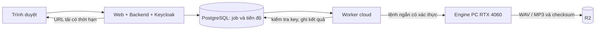

# VieNeu-TTS dùng thử và đánh giá phương án cloud + PC

## Phạm vi ngày 23/10/2026

VieNeu được thêm theo nhánh `if provider === vieneu`; giữ nguyên Edge-TTS + OpenVoice và để Edge làm mặc định. Không thay model của yêu cầu cũ. Giọng và Engine của sách được chụp vào `selected_voice`, giữ khi retry; hash audio có provider/phiên bản để không trộn cache.

Tài liệu mới của tác giả có VieNeu v3 Turbo mã nguồn mở. Tích hợp SDK `vieneu==3.8.3`, backbone `pnnbao-ump/VieNeu-TTS-v3-Turbo`, revision `61b85e3d937fbbacb387714180e8182823512523`. Runtime CPU/ONNX nằm trong service `vieneu` riêng, không cài chung vào venv OpenVoice. Weight/cache giữ trong volume `vieneu-cache`; lần đầu phải tải. Không dùng dịch vụ v4 trả phí.

## Dùng trên web

1. Tại Bài giảng hoặc Sách nói, chọn **Bộ tạo giọng → VieNeu-TTS**.
2. Sách nói: chọn giọng có sẵn Hải Đăng, Trúc Ly, Thiện Minh (mẫu kể chuyện), Mai Anh (mẫu bản tin), hoặc giọng cá nhân có quyền dùng. Bài giảng dùng thư viện giọng mẫu hiện có.
3. Xem cách đọc → Nghe thử → duyệt/tạo âm thanh như trước. SRT, khoảng nghỉ, bản nháp, lịch sử và quyền truy cập vẫn dùng luồng hiện tại.
4. Muốn quay lại, chọn Edge-TTS + OpenVoice trước khi gửi yêu cầu mới. Yêu cầu cũ không đổi Engine khi bạn đổi dropdown tạo yêu cầu mới.

VieNeu tạo tiếng nói và clone trực tiếp, không cần tạo âm thanh Edge rồi chuyển qua OpenVoice. Mẫu clone được chuẩn hóa và lấy 8 giây đầu để tái sử dụng embedding trong dịch vụ. Chọn mẫu rõ tiếng, không nhạc, không khoảng im lặng dài ở đầu. Tính giống giọng phải nghe đánh giá thực tế.

**Giọng điệu:** v3 Turbo lấy phong cách từ giọng tham chiếu; tham số `style` trong SDK hiện bị bỏ qua. Các preset Giảng giải/Kể chuyện trên web tiếp tục điều chỉnh tốc độ/khoảng nghỉ; không được mô tả là điều khiển cảm xúc gốc của model. Những thẻ cười/thở dài trong upstream còn thử nghiệm và chưa bật trên web. Tốc độ được áp bằng FFmpeg `atempo` sau tổng hợp, giữ cao độ.

## Máy hiện tại và máy bàn RTX 4060

Máy đang thao tác nhận Intel Arc 140T. Theo người dùng, RTX 4060 nằm ở PC khác. CPU image là bản chạy tại máy này; chưa có số đo trên RTX 4060.

```powershell
.\deploy\stack.ps1 build -Service vieneu
.\deploy\stack.ps1 up
.\deploy\stack.ps1 logs -Service vieneu
```

Trên máy bàn NVIDIA đã có toàn bộ repo/cấu hình/data cần thiết, Docker Desktop Linux containers + WSL2 và driver NVIDIA hỗ trợ GPU, dùng thêm overlay GPU:

```powershell
docker compose --env-file keycloak/.env -f keycloak/compose.yaml -f deploy/compose.app.yaml -f deploy/compose.vieneu.gpu.yaml build vieneu
docker compose --env-file keycloak/.env -f keycloak/compose.yaml -f deploy/compose.app.yaml -f deploy/compose.vieneu.gpu.yaml up -d --wait --wait-timeout 1800
```

Overlay chỉ cấp NVIDIA GPU cho VieNeu; không thay CPU image/requirements của Engine OpenVoice cũ. GPU image dùng PyTorch CUDA 2.8.0/cu128 theo SDK, batch tối đa 4 chunk nội bộ một lần infer. Không chạy nhiều infer GPU đồng thời chưa đo VRAM. Chưa build/chạy GPU image trên laptop này. Hai máy không tự có cùng dữ liệu chỉ vì cùng repo: cần kế hoạch backup/chuyển database và file trước khi chuyển nơi chạy stack.

## Đánh giá hai ảnh đề xuất

| Đề xuất | Quyết định / điều chỉnh |
|---|---|
| Web + Backend + Worker + PostgreSQL + Keycloak trên cloud | Hướng phù hợp. Với demo, một VPS chạy Compose giúp giảm số nơi cấu hình. Nếu frontend ở Vercel thì Backend/worker/Keycloak cần môi trường dịch vụ thường trực riêng; không coi mọi thành phần là Vercel Functions. |
| Engine trên PC RTX 4060 | Phù hợp để giảm tiền thuê GPU. PC cần bật khi xử lý; website có thể mở 24/7 nhưng việc tạo âm thanh không bảo đảm 24/7 nếu PC tắt/mất mạng. Cần trạng thái chờ Engine và heartbeat. |
| Cloudflare Tunnel / Tailscale | Có thể dùng, nhưng chưa mở tunnel. Tunnel cần service authentication; Tailscale cần cả bên cloud và PC tham gia mạng riêng. Không public endpoint quản trị/model tùy ý. |
| Chỉ đổi ENGINE_URL sang địa chỉ PC | **Chưa đủ:** worker hiện đọc đường dẫn output_path qua volume dùng chung, restore WAV từ R2 cũng ghi vào filesystem của worker. Khi khác máy phải có giao thức chuyển file theo job/part, upload Engine→R2 và trả key+checksum, tải về có xác thực hoặc presigned URL. Không gửi đường dẫn đĩa PC cho worker cloud đọc. |
| Upload Engine thẳng R2 | Nên làm trong bước tách hạ tầng. Cần idempotency, giới hạn prefix/job, checksum, xác thực chủ sở hữu, dọn file và ghép phần ngay trên PC. Bản dùng thử hiện vẫn upload từ Backend/worker như cũ. |
| CUDA cho Docker | Đã chuẩn bị overlay VieNeu cho RTX 4060. Không áp `driver:nvidia` lên Intel Arc. Có thể làm overlay CUDA OpenVoice riêng sau nếu còn dùng và cần tăng tốc nó. |
| Gọi Edge song song | Đã thêm prefetch 1–3 đoạn cho nhánh Edge trong sách review-v1 và bài giảng đầy đủ; network ngoài khóa OpenVoice, inference vẫn tuần tự. Không giúp VieNeu vì VieNeu không gọi Edge. Xem BOOK_AUDIO.md để cấu hình và giới hạn. |
| Gom 50.000–100.000 ký tự vào một lượt Gemini | Chưa áp mức này: ngân sách token hiện 24.000/lượt, đầu ra có giới hạn và context lớn không tự bảo đảm giữ đủ chi tiết. Bản này cho yêu cầu mới dùng 12.000 ký tự/phần (cấu hình 6.000–16.000), giảm số lượt phân tích với nguồn dài. Job cũ giữ 6.000; cache tách theo kích thước phần để giữ source_ids đúng. Có thể đặt lại BOOK_ANALYSIS_CHUNK_CHARS=6000 cho yêu cầu mới. |
| Gộp viết và đối chiếu vào cùng prompt | Giữ đối chiếu riêng. Tự kiểm tra trong cùng lượt viết không tương đương lượt đánh giá độc lập, đặc biệt sau các lỗi lệch nguyên tác. Checkpoint chỉ kiểm tra lại mục thay đổi để tiết kiệm lượt. |
| Giảm 28 phút xuống 2–4 phút | Chưa có bằng chứng trên dữ liệu/máy này. Cần đo riêng phân tích, viết, đối chiếu, chờ quota, TTS, ghép, upload; phân biệt model nóng và lần tải weights đầu tiên. Không hứa thời gian toàn luồng từ benchmark TTS của tác giả. |

## Luồng cloud đề xuất cho bước sau



Nên chuyển lệnh tạo đoạn sang trả task ID nhanh + polling/heartbeat thay vì giữ HTTP lâu xuyên tunnel; triển khai lease/idempotency và hủy theo job trước. Đối với bài giảng, cũng cần chuyển tác vụ đồng bộ dài thành job nếu Backend chạy trên cloud. Bản hiện tại là thử VieNeu local, chưa phải bản cloud tách máy hoàn chỉnh.

## Ghi nhận dùng thử local

Ngày 23/10/2026: build/cú pháp đạt, VieNeu CPU nạp model và báo healthy. Đã tạo một mẫu giọng Thiện Minh qua nhánh `/book/part` mới: âm thanh 9,309875 giây (gồm 650 ms nghỉ cuối), tổng lượt gọi lần đầu 22,17 giây. Đây chỉ là một đoạn ngắn, chưa phải benchmark sách dài; chưa đánh giá chất lượng bằng nghe hoặc chạy clone/luồng web toàn bộ. Không gọi Gemini, không tạo bản ghi lịch sử/job cho mẫu này, chưa dùng GPU RTX 4060.

File: `backend/data/book-audio/e59737c6da3e4d88bb607cc0/2d217b3e225b26cae74af09bcccb1b1aabdf1633fe2e12d7e156448a0891dc84.wav`.

## Biểu cảm thử nghiệm trong bản duyệt sách nói

**Trạng thái mới nhất 25/10/2026: tạm ẩn trên giao diện theo phản hồi chất lượng nghe.** Màn hình duyệt hiện chỉ giữ tốc độ, không hiện ba nút biểu cảm. Khi mở nháp cũ có bật biểu cảm, giao diện tắt cờ trước lần lưu/nghe thử/duyệt tiếp theo; vị trí thẻ vẫn được giữ trong markup nhưng bỏ qua khi đọc. Không thay đổi file cũ. Phần dưới ghi lại thiết kế thử nghiệm để có thể bật lại sau.

Chỉ nhánh VieNeu có tùy chọn **Biểu cảm thử nghiệm**, tắt mặc định. Sau khi tạo bản tóm tắt, bật tùy chọn trong phần duyệt, đặt con trỏ vào một ô nội dung rồi bấm **Cười**, **Thở dài** hoặc **Hắng giọng**. Ba nút lần lượt chèn `[cười]`, `[thở dài]`, `[hắng giọng]`; có thể tự sửa/xóa vị trí thẻ trong văn bản. Giới hạn 20 thẻ cho toàn bản đọc. Gemini không tự chèn thẻ.

Bấm **Nghe thử tối đa 30 giây** để so sánh trước khi duyệt toàn bộ. Nghe thử chỉ bao phủ phần đầu; đặt thẻ trong phần đầu nếu muốn nghe ngay hiệu ứng đó. Hiệu quả phụ thuộc giọng và ngữ cảnh, không bảo đảm biểu cảm giống người diễn. Đây là token âm thanh không lời của SDK v3 Turbo, không phải tham số `style` điều khiển cảm xúc toàn bài; `style` SDK cũ đã bị bỏ qua trong phiên bản này. Các preset phong cách của ứng dụng vẫn điều chỉnh nhịp/tốc độ/khoảng nghỉ như trước.

Tắt tùy chọn để giữ vị trí thẻ trong bản duyệt nhưng bỏ qua chúng khi đọc; **Gỡ hết thẻ** xóa ba loại thẻ khỏi nội dung đang chỉnh và tắt tùy chọn. Các thay đổi được lưu khi lưu/nghe thử/duyệt, đồng thời làm mới cache nghe thử. Edge-TTS + OpenVoice vẫn giữ luồng cũ và không nhận tùy chọn biểu cảm. Nếu đổi từ VieNeu sang Edge, tắt biểu cảm trước.

Backend giữ hai dạng: `delivery.markup` có thẻ phục vụ biên tập, `section.text` không có thẻ phục vụ đối chiếu nội dung. Chỉ các phần VieNeu có thẻ được gửi `experimental_cues=true` qua Engine tới SDK. Các thẻ không bị thay bởi từ điển phát âm, không bị cắt đôi khi chia đoạn/nghe thử, không được tính là từ và không hiện trong phụ đề hoặc bản tải MD/TXT. Ước lượng tạm cộng 1 giây/thẻ; thời lượng file và timeline cuối lấy từ âm thanh thật. Mốc phụ đề bên trong từng đoạn vẫn là ước lượng, chưa căn từng từ theo tiếng cười/tiếng thở.

Không migration; tùy chọn nằm trong JSON `speech` của bản duyệt. Tùy chọn tắt được bỏ khỏi dữ liệu kế hoạch để giữ tương thích cache của cấu hình cũ. Việc bật/tắt không sửa file âm thanh đã tạo trước đó.

Kiểm tra kỹ thuật local ngày 25/10/2026: build Frontend/Backend/Engine/VieNeu đạt, các container healthy. Đã kiểm tra cổng chặn thẻ khi chưa bật, chặn cờ trên Edge và chặn token thô. Bốn mẫu giọng Hải Đăng 1,00x được tạo qua Engine trên CPU, không gọi Gemini/ghi job lịch sử/upload R2. Mẫu thường dài khoảng 4,24 giây; ba mẫu có thẻ dài khoảng 4,88 / 5,04 / 4,00 giây, cho thấy không thể coi thời lượng thẻ là hằng số hoặc mặc định thẻ luôn làm đoạn dài hơn. Đây không phải benchmark sách dài hoặc đánh giá chất lượng bằng nghe. Mẫu lưu local trong `backend/data/book-audio/27d65d5489a7b72dac5f9b91/`, có `manifest.json` ghi cấu hình/thời lượng.

Nếu chỉ cập nhật mã service và image VieNeu 3.8.3 CPU hiện tại đã có đủ dependency, có thể dùng `build --build-arg VIENEU_BASE_IMAGE=text2speech-vieneu:3.8.3-cpu vieneu` với bộ file Compose hiện tại để tái sử dụng dependency. Không dùng cách này khi đổi SDK/dependency/nền hệ thống; build thông thường vẫn lấy `engine_os`. Cache pip lúc build đã chỉ rõ `/root/.cache/pip`, tránh trỏ nhầm vào HOME của user runtime.

## Nguồn

- SDK / giới hạn style và benchmark: https://github.com/pnnbao97/VieNeu-TTS
- Model: https://huggingface.co/pnnbao-ump/VieNeu-TTS-v3-Turbo
- GPU Docker Windows: https://docs.docker.com/desktop/features/gpu/
- Tunnel: https://developers.cloudflare.com/tunnel/get-started/
- Vercel Functions: https://vercel.com/docs/functions/limitations
